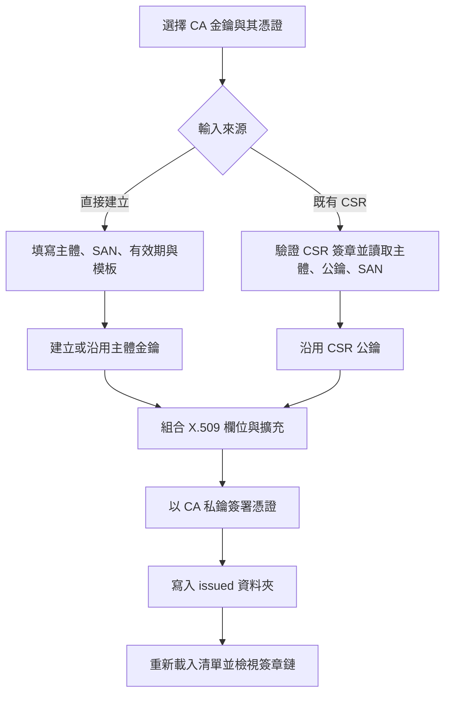
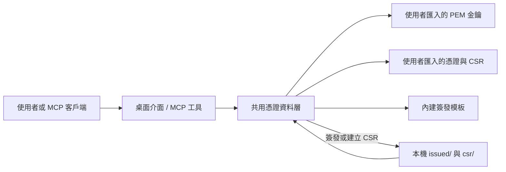

# CA Certificate

[下載 Windows x64 成品（Latest Release）](https://github.com/infycat/CA-Certificate/releases/latest/download/CA-Certificate-v1.0.0-windows-x64.zip) · [所有版本](https://github.com/infycat/CA-Certificate/releases)

CA Certificate 是一款面向 Windows 的本機 X.509 憑證與私鑰管理工具。它以圖形介面管理金鑰、憑證簽名請求（CSR）、憑證模板及簽發結果，也可在本機提供 MCP 端點，讓相容的 AI 客戶端查詢憑證資料或執行已配置的憑證工作流程。

目前下載包為 `CA-Certificate-v1.0.0-windows-x64.zip`。解壓縮後執行 `NixGCCertManager.exe`；Windows x64 以外的平台目前沒有預建成品。程式不需要另行安裝 Python。首次啟動後，將你的 CA 憑證與私鑰匯入程式資料目錄，再使用簽發功能。私鑰由使用者自行提供；此發行包不附任何 CA 私鑰或案例憑證資料。

## 功能

- **金鑰管理**：匯入及列出 PEM 私鑰，依公鑰指紋與憑證配對。
- **憑證檢視**：查看主體、簽發者、序號、有效期間、CA 約束、用途及 SHA-256 指紋。
- **CSR 建立與簽發**：以現有金鑰建立 CSR，或由選定 CA 簽發 CSR；保留 CSR 的主體、公鑰與 SAN。
- **憑證簽發**：選擇簽發者與模板，設定 Common Name、組織欄位、SAN、有效天數及序號，產生新憑證與金鑰，或依選項沿用既有金鑰。
- **常用模板**：TLS 伺服器、TLS 伺服器與用戶端、用戶端認證、程式碼簽章、中間 CA、根 CA。
- **鏈檢視與匯出**：檢視可建立的簽章鏈，匯出 PEM 憑證或鏈資料。
- **MCP 整合**：GUI 啟動時可在背景提供本機 MCP 服務，包含列出簽發者與模板、建立 CSR、簽發及檢視憑證等工具。

## 憑證簽發流程



## 生成邏輯

1. **選定簽發者**：簽發者必須有對應 CA 憑證及可用私鑰。工具比對公鑰指紋，避免把不相符的金鑰配給憑證。
2. **決定憑證內容**：使用者選擇模板並提供 subject、SAN、有效期間與序號。模板設定 Basic Constraints、Key Usage、Extended Key Usage 等 X.509 擴充。
3. **準備公鑰**：直接簽發時可產生新金鑰，或依選項沿用 CA 金鑰；CSR 簽發則採用 CSR 內的公鑰，先驗證 CSR 自身簽章。
4. **簽名**：建立待簽憑證資料，以選定 CA 私鑰簽署。EC 金鑰使用 SHA-384，RSA 金鑰使用 SHA-256。
5. **保存與載入**：憑證與私鑰以 PEM 寫入 `issued/`，再加入目前清單。私鑰檔案是未加密 PEM，應限制檔案存取並自行備份。
6. **檢視鏈**：工具沿簽發者關係檢查憑證簽章。這項檢視不等同於瀏覽器或作業系統的完整信任判定，也不會取代即時 OCSP/CRL 狀態查詢。

## 應用資料流程



MCP HTTP 端點預設綁定 `127.0.0.1:8765`，路徑為 `/mcp`。只有程式執行時端點才可用；請勿將端點綁定到公開網路或未受信任的網段。MCP 客戶端能呼叫的簽發操作使用目前載入的資料與私鑰。

## 資料與隱私

程式從執行檔旁的資料夾載入使用者資料。常見目錄如下：

| 目錄 | 用途 |
|---|---|
| `csr/` | CSR 檔案 |
| `issued/` | 新簽發的憑證與私鑰 |
| `pki/` | 使用者自行放入的測試或管理資料 |

請只匯入你有權管理的憑證與私鑰。發行檔不含本機研究資料、憑證資料庫、私鑰、設定檔或執行日誌。產生的私鑰保存在本機，程式不會替你加密 PEM 私鑰。

## 專案結構

```text
cert_manager.py   Tkinter 桌面介面
certstore.py      憑證資料層、CSR、模板、簽發與鏈檢視
mcp_server.py     GUI 共用的 MCP 服務
nixgc_cert_mcp.py 獨立 MCP 啟動入口
build_exe.py      Windows 執行檔建置入口
assets/           應用程式圖示
releases/         本機準備的可下載成品
```

## 從原始碼建置

使用 Windows、Python 3.14 及專案相依套件。安裝 `cryptography`、`mcp`、`PyInstaller` 與 MCP HTTP 傳輸所需套件後，在專案目錄執行：

```powershell
python build_exe.py --only gui
```

建置輸出位於 `dist/NixGCCertManager/`。建置輸出的目錄不會自動帶入你的憑證資料；發行前請確認執行檔目錄不含私人資料。

## 限制

- 目前提供 Windows x64 成品；其他平台請由原始碼自行建置及驗證。
- 私鑰以未加密 PEM 儲存；目前沒有 PKCS#12 匯入、HSM 整合或 CRL 產生功能。
- 內建鏈檢視不會進行完整系統信任庫判定或即時撤銷狀態查詢。
- 這是本機憑證管理與測試工具，不是面向公開網際網路的 CA 服務。
- 請遵守憑證政策、相關法規及你所管理 CA 的授權範圍。

## 版本

- **v1.0.0** — 首個 Windows x64 發行包，包含憑證管理 GUI 與內建 MCP 服務。

查看[所有 Releases](https://github.com/infycat/CA-Certificate/releases)取得版本記錄及校驗資訊。

